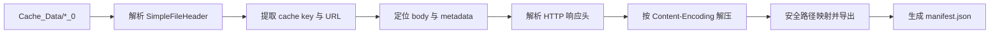

# ChromeSimpleCache：网页恢复技术分享

## 1. 背景

浏览器缓存常用于提升页面加载速度，但在应急取证、故障复盘、离线分析和页面内容追溯场景中，缓存也能作为一种本地证据来源。Chrome 的缓存目录中通常保存了访问过的 HTML、JavaScript、CSS、图片、字体、接口响应等资源。只要缓存实体尚未被清理或覆盖，就有机会从本地缓存文件中还原网页资源。

本文围绕一个 Chrome Simple Cache 恢复脚本展开，介绍如何从 `Cache_Data` 目录中解析缓存实体、提取 URL、识别响应头、恢复响应体，并通过四阶段流程完成 HTML 页面筛选和交互式导出。

## 2. Chrome Simple Cache 文件结构

Chrome Simple Cache 的独立缓存实体通常表现为 `<hash>_0` 这类文件。脚本关注的是这类实体文件，因为它们内部包含了缓存键、响应体以及 HTTP 响应元数据。

一个典型 Simple Cache v5 文件可抽象为：

```text
[SimpleFileHeader  24 bytes]
[key               key_len bytes]
[stream 1 body]
[SimpleFileEOF     24 bytes]
[stream 0 HttpResponseInfo]
[key SHA256        optional 32 bytes]
[SimpleFileEOF     24 bytes]
```

关键字段包括：

- `SimpleFileHeader`：包含 magic、version、key_len、key_hash 等字段。
- `key`：缓存键，通常包含明文 URL。
- `stream 1`：HTTP 响应体，也就是最终要恢复的资源内容。
- `stream 0`：HTTP 响应元数据，包含状态行和响应头。
- `SimpleFileEOF`：流结束标记，脚本通过它反推 body 和 metadata 的边界。

脚本中的两个 magic 常量用于识别文件结构：

```python
MAGIC_HEADER = 0xFCFB6D1BA7725C30
MAGIC_EOF = 0xF4FA6F45970D41D8
```

这里有一个容易踩坑的点：body 的结束位置不能简单依赖 EOF 里的 `size` 字段。实践中更可靠的方式是找到 metadata 前一个 EOF 的位置，再用该位置反推 body 的结束边界。

## 3. 核心恢复思路

整个恢复过程可以拆成五个动作：

1. 遍历 `Cache_Data` 目录，找到所有以 `_0` 结尾的缓存实体。
2. 读取并校验 `SimpleFileHeader`，根据 `key_len` 取出缓存 key。
3. 从 key 中提取真实 URL。
4. 从 metadata 中解析 HTTP 状态行、`Content-Type`、`Content-Encoding` 等响应头。
5. 根据 `Content-Encoding` 解压响应体，并按 URL 映射成本地文件路径导出。

整体数据流如下：



## 4. URL 提取

Chrome 缓存 key 可能是直接 URL，也可能包含 top-site、frame-site 等上下文信息，例如：

```text
1/0/_dk_<top-site> <frame-site> <url>
```

因此脚本不会简单地把整个 key 当作 URL，而是用正则匹配其中所有 `http://`、`https://`、`chrome-extension://`、`ftp://` 形式的地址，并取最后一个作为真实资源 URL。这样可以兼容带上下文前缀的缓存键。

## 5. HTTP 元数据解析

Chrome 在 metadata 中以 `\0` 分隔 raw headers。脚本从 `HTTP/` 开始定位响应头块，并在 `\0\0` 处结束解析。

解析结果会得到：

- 状态行，例如 `HTTP/1.1 200 OK`
- 响应头字典，例如 `content-type`、`content-encoding`

这些信息决定了后续两个动作：

- 使用 `Content-Encoding` 判断是否需要 gzip、deflate、br、zstd 解压。
- 使用 `Content-Type` 判断输出文件扩展名和资源分类。

## 6. 解压策略

缓存中的 body 可能是原始明文，也可能保持 HTTP 传输时的压缩形式。脚本当前支持：

- `identity`
- `gzip`
- `deflate`
- `br`
- `zstd`

其中 `gzip` 和 `deflate` 使用 Python 标准库即可处理；`br` 和 `zstd` 需要额外安装对应库。如果缺少库或解压失败，脚本不会丢弃数据，而是保留原始压缩 body，并在 manifest 中记录解压结果。

这种设计更适合恢复场景：恢复工具应优先保证数据不丢失，而不是因为某个编码暂时无法解压就跳过资源。

## 7. 四阶段运行流程

脚本现在默认按四个阶段运行。

### 7.1 扫描全部缓存 URL

第一阶段解析全部缓存实体，统计：

- 缓存文件总数
- 成功解析出的 URL 总数
- 来源服务端总数
- 每个域名对应的缓存文件数

示例输出：

```text
[1/4] 扫描全部缓存 URL
缓存文件总数: 196
总 URL 数量: 196
来源服务端总数: 9
域名缓存文件数:
  www.baidu.com: 115
  pss.bdstatic.com: 65
```

这个阶段的价值是先建立全局视角：缓存里有哪些站点、资源主要集中在哪些域名、是否存在明显的第三方静态资源域名。

### 7.2 筛选缓存 HTML 页面

第二阶段从全量 URL 中筛选网页页面。判断依据不是只看 URL 后缀，而是综合：

- `Content-Type` 是否为 `text/html` 或 `application/xhtml+xml`
- URL 路径是否以 `.html`、`.htm`、`.xhtml` 结尾
- 无明确 MIME 时，body 前部是否像 HTML
- 排除 `.js`、`.css`、图片、字体、视频等明显静态资源后缀

这里特别需要排除“静态资源 URL 返回 HTML 错误页”的情况。例如某个 `.js` 请求返回了 `text/html` 的 404 页面，它在 MIME 分类上可以算 HTML 内容，但不应作为用户要恢复的 HTML 页面展示。

### 7.3 扫描独立缓存实体

第三阶段按 MIME 类型和文件后缀对所有独立缓存实体分类：

- JS
- 图片
- 字体
- HTML
- 未知二进制文件
- 其他

这个统计用于判断缓存内容构成。如果 HTML 很少但 JS、图片很多，说明缓存更偏静态资源；如果未知二进制文件较多，则需要进一步人工分析响应头缺失或二进制内容类型。

### 7.4 交互式页面恢复

第四阶段重复展示第二阶段筛选出的 HTML 页面列表，并等待用户输入导出指令。

支持的输入规则：

```text
单序号: 3
区间: 2-5
全部: all
退出: q
```

导出后，脚本会在输出目录生成恢复文件和 `manifest.json`。manifest 会记录每个资源的缓存文件名、URL、状态行、Content-Type、Content-Encoding、解压方式、原始大小、输出大小和本地输出路径。

## 8. 输出路径安全设计

恢复资源时，脚本会把 URL 映射成本地路径，例如：

```text
https://www.example.com/a/b/index.html
```

会映射为：

```text
<out>/www.example.com/a/b/index.html
```

路径处理时需要注意：

- 移除或替换非法字符。
- 跳过空段、`.`、`..`，避免路径逃逸。
- 限制单个路径段长度。
- 根据 `Content-Type` 补充缺失扩展名。
- 同名文件使用 `__1`、`__2` 形式去重，避免覆盖。

这些细节在恢复工具中很重要，因为缓存 URL 可能包含特殊字符、空路径、重复路径甚至异常构造的路径段。

## 9. 常见缓存路径

Chrome 的缓存目录会随操作系统、用户配置和 Profile 名称变化。常见路径如下：

Windows:

```text
C:\Users\用户名\AppData\Local\Google\Chrome\User Data\Default\Cache
```

macOS:

```text
~/Library/Caches/Google/Chrome/Default/Cache
~/Library/Caches/Google/Chrome/Profile 3/Cache
```

## 10. 效果


被还原的页面：


## 11. 适用场景

这类缓存恢复技术适合：

- 本地网页内容恢复
- 浏览器访问痕迹辅助分析
- 前端资源离线排查
- 页面加载失败后的缓存回溯
- 应急响应中的本机缓存取证
- 内网横向信息搜集

在企业内网安全评估或应急响应中，浏览器缓存还可以作为横向信息搜集的辅助数据源。通过缓存 URL、域名分布、路径结构、静态资源命名和接口响应类型，可以快速还原用户曾访问过的内网系统、业务入口、静态资源服务和部分技术栈线索。这类信息适合用于资产梳理、访问路径复盘和影响面判断。

不过它也有边界：

- 缓存可能被清理或覆盖。
- HTTPS 不影响浏览器本地缓存内容，但不代表所有响应都会被缓存。
- 动态页面可能依赖接口、Cookie、LocalStorage、IndexedDB 等额外状态，单独恢复 HTML 不一定能完整复现页面。
- 部分资源可能仍是 br 或 zstd 压缩格式，需要额外库才能解压。
- 响应头带有 `Cache-Control: no-store` 时，浏览器通常不会把响应持久写入磁盘缓存；`no-cache` 则表示缓存复用前需要重新验证，实际是否留下可恢复实体取决于浏览器实现和当时访问状态。
- 浏览器磁盘缓存有容量上限，空间不足或缓存压力较高时，旧资源可能被淘汰，实体文件不存在时无法恢复。
- 无痕模式会把缓存限定在临时会话中，窗口关闭后相关缓存通常会被清理，因此事后从常规磁盘缓存目录恢复的概率很低。

## 12. 小结

Chrome Simple Cache 恢复的关键不在于暴力搜索文件内容，而在于正确理解缓存实体结构：先定位 header 和 key，再用 EOF 反推 body 与 metadata 边界，最后结合 HTTP 响应头完成解压、分类和落盘。

在此基础上，四阶段流程把恢复过程变得更可控：

- 先看全局 URL 和域名分布。
- 再筛出真正的 HTML 页面。
- 同时掌握缓存实体的 MIME 构成。
- 最后由用户交互选择需要恢复的页面。

这种流程既保留了批量恢复能力，也避免把大量静态资源和错误页混入页面恢复结果，适合在取证、排障和离线分析场景中使用。
